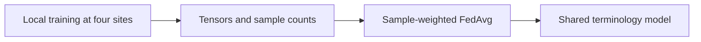
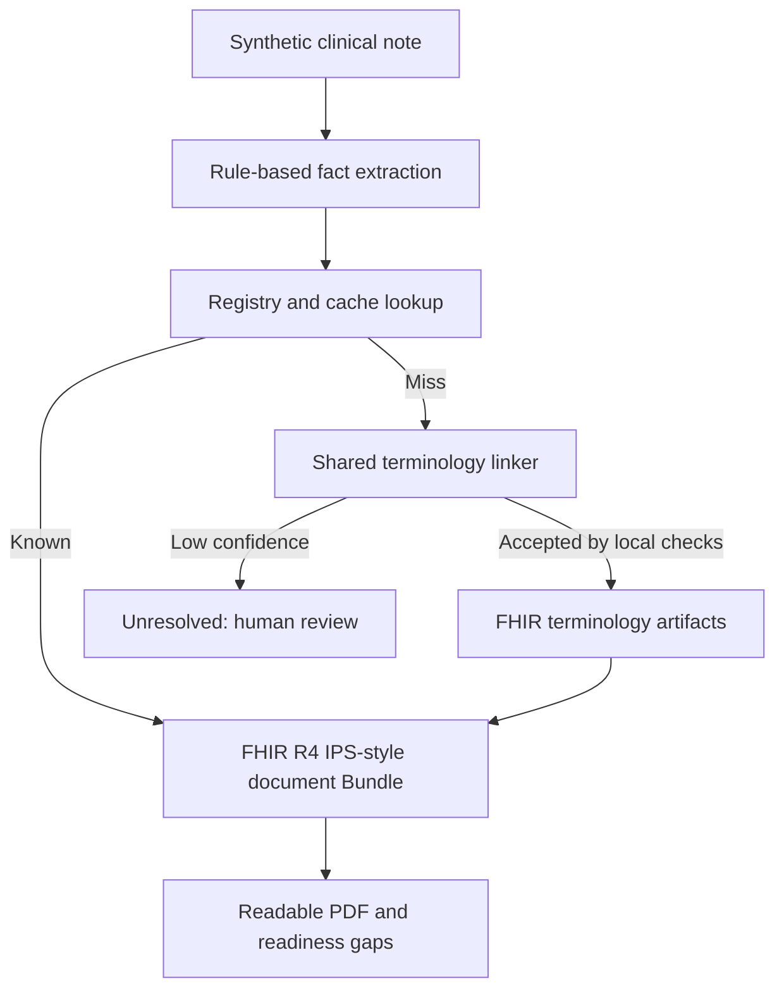
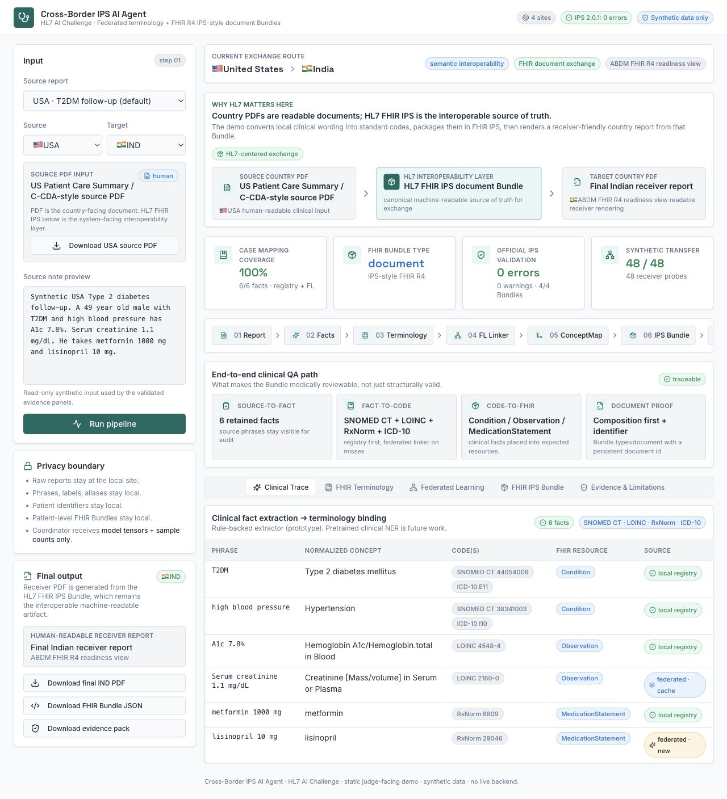

# Cross-Border IPS AI Agent

**Federated terminology learning and HL7 FHIR patient summaries for a synthetic cross-border diabetes case study.**

Tech Adaptive Pandit · HL7 AI Challenge 2026 submission · Research prototype

[Open demo](https://crossroad-fhir-link-three.vercel.app) · [Watch demonstration](https://crossroad-fhir-link-three.vercel.app/cross-border-ips-ai-agent-demo.mp4) · [Pitch deck](submission/final_pitch_deck_TAP_revised.pdf) · [Architecture](submission/architecture_one_page.pdf)

## At a glance

A clinical report can travel with a patient while its meaning remains difficult for the receiving electronic health record (EHR) to use. Local wording, abbreviations, and incompatible document structures create work at every handoff.

This project studies two parts of that problem: **aligning clinical terminology** and **packaging the result for exchange**. A small federated model learns terminology across four simulated sites. HL7 FHIR terminology resources record the mappings, and a FHIR International Patient Summary (IPS) document Bundle carries the coded facts. PDFs provide readable views for clinicians.

**Research question:** Can local terminology examples improve a shared terminology linker without pooling those examples at the training coordinator, while retaining an auditable path into FHIR IPS?

**Scope:** Type 2 diabetes; India, USA, Australia, and a simulated Europe ecosystem; synthetic data throughout. Europe is an illustrative site label, not a single national healthcare system.

## Start here

- **Understand the approach:** [Method and architecture](docs/methodology.md), including what is trained, where FedAvg fits, and how FHIR is used.
- **Assess the evidence:** [Evaluation and limitations](docs/evaluation.md), with raw results and the meaning of each validation check.
- **Run the implementation:** [Reproduction guide](docs/reproduction.md) for the Python pipeline, federated experiment, and React demo.
- **Inspect the submission:** [Submission asset index](submission/README.md) for PDFs, validator logs, downloadable examples, and video.

## The problem and intended benefit

In our synthetic examples, clinicians may write `T2DM`, `madhumeha type 2`, or `type 2 DM`. A receiving system needs an explicit clinical meaning, standard coding, and predictable fields to reuse that information.

The intended benefit is less manual recoding and more reviewable exchange: a reader can trace a source phrase through its concept and codes to its FHIR resource. Workflow savings and patient outcomes have not been measured in clinical practice.

Ambiguous expressions such as `sugar disease` do not, by themselves, establish a diabetes subtype. The curated case-study labels must not be treated as universal clinical equivalences.

## How the approach works

Training and report conversion are separate workflows. The model learns from terminology mentions; patient Bundles are downstream outputs.



The shared model supplies the learned fallback during local report conversion:



1. **Extract facts.** The Python extractor identifies supported conditions, measurements, and medications using deterministic rules, retaining source text, values, and units.
2. **Resolve terminology.** Known mappings take priority. For a registry miss, an optional federated classifier predicts one of 12 canonical concepts within the fact's category.
3. **Make the mapping inspectable.** Local `CodeSystem`, `ValueSet`, and `ConceptMap` resources describe terms, allowed targets, and mappings. Local terminology-operation simulations check the curated registry and record an audit trace. Accepted learned mappings are reused in memory.
4. **Build the exchange document.** The IPS builder creates a FHIR R4 document Bundle with `Composition` first and resources such as `Patient`, `Condition`, `Observation`, and `MedicationStatement`.
5. **Show receiver gaps.** The demo renders a readable country-oriented PDF and readiness findings against selected ecosystem guides.

**FHIR IPS is the machine-readable exchange artifact. PDFs are human-readable renderings.** Receiver readiness checks do not establish national certification or automatic acceptance by an EHR.

## Why federated learning is used

The task is terminology classification: a local phrase and its category are mapped to a known canonical concept. Each simulated site holds its own labelled examples. Local SGD changes a PyTorch linear model's weights; the coordinator averages the updates by sample count and broadcasts the resulting model.

The model uses deterministic signed word and character n-gram hashing with 1,024 features. Defaults are five rounds, ten local epochs per round, batch size 16, and learning rate 0.1. The [method guide](docs/methodology.md#federated-training) explains the formula and implementation.

The implementation performs real local optimization and FedAvg in **one process with simulated clients**. It demonstrates data locality. Model updates can still leak information; secure aggregation and differential privacy are future work.

## Recorded results

The checked-in study uses five seeds: `7`, `21`, `42`, `84`, and `126`.

- **768 training mentions:** 12 concepts × 4 sites × 16 distinct mention strings. The separate report case study contains 20 reports.
- **48 transfer probes:** federated top-1 predictions were **48/48**, compared with **47/48** for receiver-local models at every seed. That is one additional correct prediction, or 2.08 percentage points, with no receiving-site regression.
- **192 globally unseen mentions:** federated top-1 accuracy was **100%**, macro-F1 **1.000** at every seed. Mean local-only accuracy was **94.27%**, with a sample standard deviation of **0.26 percentage points** across seeds.
- **Four representative FHIR Bundles:** July 2026 logs record **0 errors and 0 warnings** with HL7 FHIR Validator 6.9.11 and IPS 2.0.1. Each retains two informational medication value-set notes.
- **Representative external terminology checks:** four target codes passed `$lookup` and `$validate-code` in the stored tx.fhir.org snapshot. Source-phrase `$translate` runs locally.

Transfer mentions were seen during sender training and unseen by the receiver's local-only model. The 192 globally unseen mentions were excluded from all training and transfer pools. Reported classifier metrics use category-constrained top-1 predictions; inference additionally applies a `0.70` confidence threshold.

These results establish behavior on a small, templated synthetic benchmark. They do not establish clinical accuracy, broad language coverage, or clinical benefit. [Read the evaluation](docs/evaluation.md) and inspect the [five-seed JSON](submission/federated_multiseed_benchmark.json).

<details>
<summary>View a recorded demonstration screenshot</summary>



The public React application presents embedded synthetic evidence. Run the Python prototype to execute training and conversion.

</details>

## Run locally

Clone the repository once:

```bash
git clone https://github.com/AnantGp/crossroad-fhir-link.git
cd crossroad-fhir-link
```

For the Python experiment, use Python 3.10 or later; Python 3.11 is used in CI:

```bash
cd prototype
python3 -m venv .venv
source .venv/bin/activate
python -m pip install -e . pytest
python -m pytest -q
python -m ips_agent.cli federated-demo \
  --rounds 5 --seed 42 --hash-dim 1024 --out outputs/federated-demo.json
```

For the presentation app, start in the repository root with Node.js 20:

```bash
npm ci
npm run dev
```

The app opens at the URL printed by Vite. It uses embedded evidence and does not train a model or send edited notes to the Python API. See the [reproduction guide](docs/reproduction.md) for a single-report run, the five-seed study, and optional API.

## Repository map

```text
prototype/                 Python pipeline, FedAvg implementation, data, and tests
src/                       React/TypeScript presentation app and UI tests
docs/                      Method, evaluation, and reproduction guides
submission/                July 2026 submission assets and evidence
  downloads/               Representative input/output PDFs and FHIR JSON
  official_validation/     Raw validator logs and summary
  screenshots/             Recorded demo and evidence views
scripts/                   Submission document, video, and evidence tooling
.github/workflows/         Frontend and Python verification
CITATION.cff               Software citation metadata
```

## Limitations and next research steps

The extractor has limited rule coverage; arbitrary multilingual notes, negation, temporality, OCR, and production EHR ingestion need further work. The clinical fact model is a structured JSON-compatible model, with no graph database. The linker selects among known concepts and does not discover new clinical codes. Its confidence threshold is a heuristic rather than a calibrated clinical guarantee.

Terminology services are simulated locally, alongside a dated external code-validation snapshot. National guides inform readiness checks only. The independent clinical review packet is pending signature. Future work includes clinician-labelled external data, calibration and abstention evaluation, production terminology integration, secure aggregation, differential privacy, and authorized EHR pilots.

## Team and citation

**Tech Adaptive Pandit:** Anant Gupta, Manish Gupta, and Gourav Gupta.

This repository accompanies the team's HL7 AI Challenge 2026 prototype submission. Use GitHub's **Cite this repository** control, or [CITATION.cff](CITATION.cff), and include the commit SHA when reporting experiments.

The submitted implementation snapshot is [`88f58bf`](https://github.com/AnantGp/crossroad-fhir-link/commit/88f58bfc2d6a1752b6bfa962cc0508f7008faea0). The reading guides were refreshed in October 2026; historical evidence retains its original dates. No software license is currently declared; contact the authors before reuse that requires permission.
